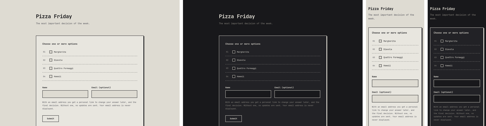
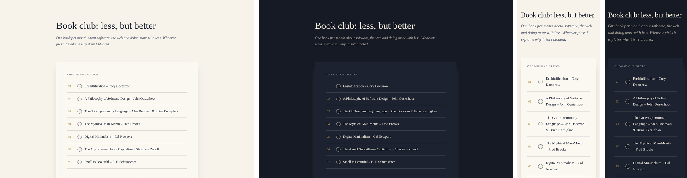
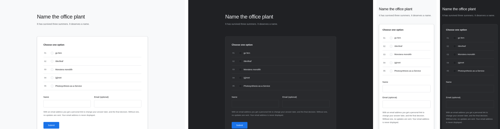
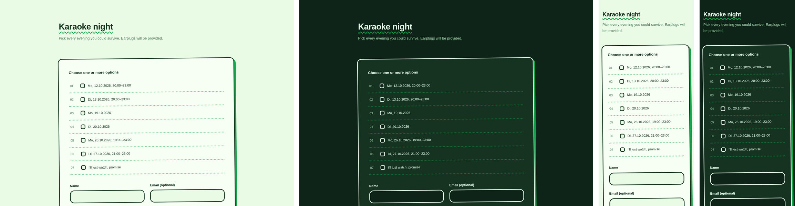

**Live demo: [poll.nobloat.org](https://poll.nobloat.org)**

There is also an [article](https://nobloat.org/articles/2026-10-11-nobloat-poll.html) about this.

A minimal alternative to Doodle, born out of frustration with it's ongoing *enshiti***ion*.

- **Plain Go stdlib only**, no dependencies (see [go.mod](go.mod)), plus a little JavaScript and CSS
- One statically compiled binary, in the spirit of [nobloat.org](https://nobloat.org)
- **No** *node*, *npm*, *react/svelte/angular/vue* or database

## Features

- Create and ansswer polls without an account
- Optional mails via SMTP with personal links to manage a poll or change an answer
- GDPR friendly: each poll is one `.json` file
- Spam protection without CAPTCHAs with proof of work
- Admin (Basic Auth) can list and manage all polls
- Easy [theming](#theming), with light and dark mode.
- [Translations](#translations): English, German, French, Spanish

## Non-features

- Scaling to millions of polls with thousands of participants voting at the same time

## Screenshots

**minimal**



**elegant**



**business**



**fun**



## Development

```sh
make dev          # Mailpit (mail UI on http://localhost:8025) + go run . (creates .env from .env.sample)
make test         # go vet + go test -race
make build        # static ./poll binary
make package      # Docker image ghcr.io/nobloat/poll:<git tag, or main>
make push         # package + push (TAG=… to override)
make screenshots  # all pages × themes × desktop/phone × light/dark (needs chromium + ImageMagick)
```

- Admin: http://localhost:8737/a (`admin` / `admin`)
- Example polls: an empty `./data` gets the polls from `seed/`; `rm -rf data` resets them

## Deployment

- Configure with environment variables; [`.env.sample`](.env.sample) documents every setting
- Listens on `:8737` (`PORT` to change), stores polls in `./data` (`/data` in the image)
- Startup validates the config; mail is queued on disk and retried after SMTP failures or restarts

```sh
mkdir data
docker run -d --restart unless-stopped --env-file .env --user 1000:1000 -v ./data:/data \
  -p 127.0.0.1:8737:8737 ghcr.io/nobloat/poll:latest
```

Or with Docker Compose:

```yaml
services:
  poll:
    image: ghcr.io/nobloat/poll:latest
    restart: unless-stopped
    env_file: .env
    user: "1000:1000"
    volumes: [./data:/data]
    ports: ["127.0.0.1:8737:8737"]
```

## Theming

- Built-in themes in [`static/themes/`](static/themes): `minimal` (default), `elegant`, `business`, `fun`
- `THEME` sets the default; each poll can pick its own in the poll form
- A theme is a small CSS file that overrides the `:root` variables in [`static/app.css`](static/app.css) (colors, font, borders, corners, shadows, buttons) and may refine any other rule
- Add one: put it in `static/themes/<name>.css` and rebuild, it's picked up automatically
- Use `light-dark(light, dark)` for colors
- Fonts: only the built-in generic families (`system-ui`, `ui-monospace`, `ui-serif`, `ui-rounded`, `sans-serif`, …), no font files

## Translations

- All texts, including mails, are in [`i18n/`](i18n): `en.json`, `de.json`, `fr.json`, `es.json`
- Add a language: copy `en.json` to `<code>.json` (e.g. `it.json`), translate the values (keep keys and `%s` placeholders), rebuild
- The language comes from the browser's `Accept-Language`, English is the fallback
- Mails use the language a participant had when they answered
- `make test` fails if a file is missing a key or has extra ones
